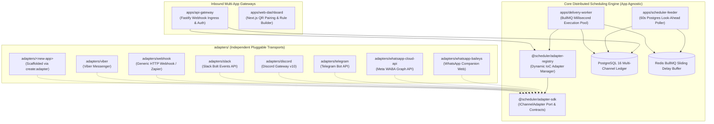

# Omnichannel & Multi-App Message Scheduler Platform

> **Architecture**: Pluggable Hexagonal Monorepo (Turborepo + npm workspaces + TypeScript)  
> **Source Trajectory**: `509c36c6-11b3-438e-94fd-89af46ad744c`  
> **Status**: Monorepo Boilerplate Initialized & Verified across 21 Workspaces  

---

## 📌 Executive Summary

The **Omnichannel Message Scheduler** is an enterprise distributed platform designed to schedule, queue, and deliver messages across any communications channel or 3rd-party application (WhatsApp, Telegram, Discord, Slack, Signal, Viber, SMS/Twilio, Line, Email, and generic Webhooks) with **millisecond precision, zero-knowledge encryption, and policy-aware rate limiting**.

The codebase is structured as a **Clean Architecture / Hexagonal Monorepo**: the core distributed scheduling, queuing, and database primitives are completely decoupled from messaging transports. Specialized developer squads can build, test, and release independent channel adapters in complete isolation without touching core microservices.

---

## 🏗️ Monorepo Architecture Overview



---

## 📂 Monorepo Workspaces Layout

```tree
scheduler/
├── package.json                         # Root workspaces definition (apps, packages, adapters, tools)
├── turbo.json                           # Turborepo task pipeline & caching
├── tsconfig.base.json                   # Root TypeScript compiler options
├── .gitignore                           # Git ignore rules
├── .editorconfig                        # Code formatting consistency
├── .env.example                         # Master environment variable template
│
├── apps/                                # Deployable Services
│   ├── api-gateway/                     # Fastify Inbound Webhooks & REST API (/api/webhooks/:channelId)
│   ├── scheduler-feeder/                # 60s look-ahead cron feeder (DB -> Redis)
│   ├── delivery-worker/                 # BullMQ execution worker pool invoking dynamic adapters
│   └── web-dashboard/                   # React/Next.js administration console & QR linking
│
├── adapters/                            # Pluggable App Integrations (Independent Workspaces)
│   ├── whatsapp-baileys/                # WhatsApp Companion Multi-Device Socket (Noise_XX)
│   ├── whatsapp-cloud-api/              # Meta Graph API (Official Business WABA)
│   ├── telegram/                        # Telegram Bot API (Telegraf / Grammy)
│   ├── discord/                         # Discord Gateway Bot (Discord.js v10)
│   ├── slack/                           # Slack Bolt App
│   ├── webhook/                         # Generic Outbound HTTP Webhook / Zapier / Make
│   ├── viber/                           # Viber Messenger REST Bot
│   └── README.md                        # Comprehensive guide on creating new adapters
│
├── packages/                            # Shared Internal Libraries (Strict Boundaries)
│   ├── adapter-sdk/                     # Universal IChannelAdapter interface & capabilities
│   ├── adapter-registry/                # Dynamic IoC adapter registration & retrieval
│   ├── adapter-test-kit/                # Standardized contract test suite for any new adapter
│   ├── types/                           # Universal DTOs, Enums, Job schemas
│   ├── database/                        # PostgreSQL layer with Prisma ORM
│   ├── queue/                           # BullMQ abstraction & Redis manager
│   ├── crypto/                          # AES-256-GCM zero-knowledge envelopes
│   ├── temporal/                        # Timezone & DST Recurrence Engine
│   ├── logger/                          # Pino structured logger & PII redactor
│   └── config/                          # Zod-validated environment config
│
├── tools/                               # Developer Velocity Tooling
│   ├── create-adapter/                  # CLI generator: npm run create:adapter -- --name <channel>
│   └── typescript-config/               # Shared tsconfig bases
│
├── docker/                              # Local Development Orchestration
│   ├── docker-compose.yml               # Local Postgres 16 & Redis 7
│   └── Dockerfile.base                  # Base container image
│
├── docs/                                # Architectural Specifications, PRDs, BRDs & Transcripts
│   ├── Omnichannel_Scheduler_BRD_FRD_ScaleOut.html # Presentation HTML
│   ├── Omnichannel_Scheduler_BRD_FRD_ScaleOut.pdf  # Presentation PDF
│   ├── WhatsApp_Scheduler_Master_Technical_Plan.html
│   ├── WhatsApp_Scheduler_Master_Technical_Plan.pdf
│   ├── Partner_Meeting_Briefing_QnA.html
│   ├── Partner_Meeting_Briefing_QnA.pdf
│   └── conversation_transcript.md       # Formatted 13-turn conversation transcript
│
└── conversations/
    └── 509c36c6-11b3-438e-94fd-89af46ad744c/ # Complete raw conversation archive & SQLite database
```

---

## ⚡ Quickstart & Development

### 1. Prerequisites
- **Node.js**: `>= 20.0.0` (Tested on `v25.8.0`)
- **npm**: `>= 10.0.0` (Tested on `11.11.0`)
- **Docker**: For running local PostgreSQL and Redis

### 2. Start Local Infrastructure
```powershell
docker compose -f docker/docker-compose.yml up -d
```

### 3. Build All Workspaces
Turborepo orchestrates the build pipeline across all packages and adapters with topological caching:
```powershell
npm run build
```
Subsequent builds run with **FULL TURBO** cache in `< 300ms`.

### 4. Run Development Services
```powershell
npm run dev
```

---

## 🚀 Adding a New App Integration

For engineering squads adding a new messaging or app integration (e.g. Signal, Line, WeChat, Twilio SMS, PagerDuty):

```powershell
# 1. Run the scaffolding CLI
npm run create:adapter -- --name line --display "LINE Messenger"

# 2. Build the monorepo (the new adapter compiles immediately)
npm run build
```

The scaffolding tool automatically creates:
- `adapters/line/package.json`
- `adapters/line/tsconfig.json`
- `adapters/line/src/line.adapter.ts` (implementing `IChannelAdapter`)
- `adapters/line/src/index.ts`

Refer to [adapters/README.md](file:///d:/Dev/repos/scheduler/adapters/README.md) for step-by-step guidance.

---

## 📑 Specifications & Architecture Documentation Index

| Deliverable | Formats | Overview |
| :--- | :--- | :--- |
| **Omnichannel Scale-Out BRD & FRD** | [HTML](file:///d:/Dev/repos/scheduler/docs/Omnichannel_Scheduler_BRD_FRD_ScaleOut.html) \| [PDF](file:///d:/Dev/repos/scheduler/docs/Omnichannel_Scheduler_BRD_FRD_ScaleOut.pdf) | Market analysis & multi-platform specifications |
| **Master Technical Plan (HLD & LLD)** | [HTML](file:///d:/Dev/repos/scheduler/docs/WhatsApp_Scheduler_Master_Technical_Plan.html) \| [PDF](file:///d:/Dev/repos/scheduler/docs/WhatsApp_Scheduler_Master_Technical_Plan.pdf) | Deep system architecture, database diagrams & workflows |
| **WhatsApp BRD & FRD** | [HTML](file:///d:/Dev/repos/scheduler/docs/WhatsApp_Scheduler_BRD_FRD.html) \| [PDF](file:///d:/Dev/repos/scheduler/docs/WhatsApp_Scheduler_BRD_FRD.pdf) | Business requirements for WhatsApp MVP |
| **Partner Briefing & Q&A** | [HTML](file:///d:/Dev/repos/scheduler/docs/Partner_Meeting_Briefing_QnA.html) \| [PDF](file:///d:/Dev/repos/scheduler/docs/Partner_Meeting_Briefing_QnA.pdf) | 16 strategic partner/investor questions answered |
| **Full Conversation Transcript** | [Markdown](file:///d:/Dev/repos/scheduler/docs/conversation_transcript.md) | Turn-by-turn history of design choices and Q&A |
