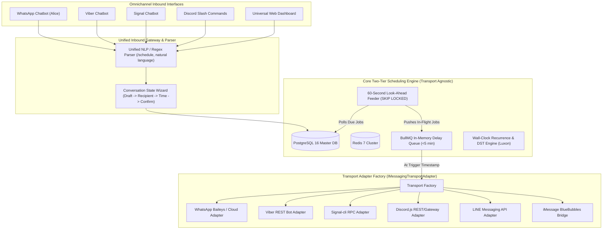
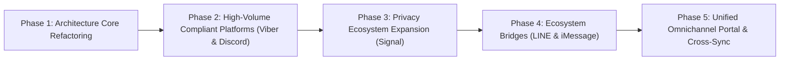

# Omnichannel Message Scheduler: Comparative Landscape & Scale-Out Plan

## 1. Executive Summary & Purpose

This document provides a comprehensive market analysis and architectural expansion plan for scaling the **WhatsApp Scheduler Bot** into a multi-platform **Omnichannel Scheduled Messaging Engine**. 

While the existing system was engineered specifically for WhatsApp using a **Two-Tier Hybrid Scheduler** (PostgreSQL 16 look-ahead feeder + BullMQ Redis buffer), the underlying scheduling primitives (transactional state machines, single-active-row recurrence, wall-clock DST invariance, and zero-double-send idempotency) are completely **transport-agnostic**.

This plan investigates all major global messaging ecosystems that currently lack robust native scheduling for personal accounts, analyzes their integration feasibility, and outlines the step-by-step technical architecture to support them via a unified adapter pattern.

---

## 2. Global Messaging Platforms Landscape Analysis

Below is an exhaustive comparative breakdown of the world's leading messaging applications, evaluating their native scheduling capabilities, architectural constraints, and integration feasibility.

| Platform | Global Reach (MAU) | Native Scheduling in Personal 1-to-1? | Native Recurrence (Cron)? | Cloud-Queued vs Local Device? | Integration Feasibility & Method | Ban / Policy Risk | Target Geography / Persona |
| :--- | :--- | :--- | :--- | :--- | :--- | :--- | :--- |
| **WhatsApp** | ~2.8 Billion | **NO** (Only business greeting/away tools) | None | N/A | **High**: Baileys (MD multi-device socket) or Cloud API | Low–Medium (Requires human typing emulation & warm-up) | Global (Europe, LATAM, India, Africa) |
| **Viber** (Rakuten) | ~1.1 Billion (reg) / ~250M MAU | **NO** (Only available in Channels / Communities for Admins) | None | N/A | **High**: Official Viber REST Bot API & Webhooks | **Very Low** (Official bot platform allows programmatic push) | Eastern Europe, Balkans, Greece, Philippines, Myanmar |
| **WeChat / Weixin** (Tencent) | ~1.35 Billion | **NO** (Only manual "Chat Reminders" that alert you to type) | None | N/A | **Low–Medium**: WeCom (Enterprise API) or Wechaty Puppet bridge | **Critical / High** (Extreme anti-bot detection; risk of WeChat Pay freeze) | Mainland China, East Asia, Global Chinese Diaspora |
| **Signal** | ~50 Million | **Partial / Android Only** (iOS & Desktop have **NO** scheduling) | None (One-time only) | **Strictly Local** (Fails if phone is off or offline at dispatch time) | **High**: `signal-cli` (JSON-RPC daemon linked as secondary device) | **Low** (Linked multi-device client with libsignal compliance) | Global Privacy advocates, Journalists, Executives, Security pros |
| **Discord** | ~200 Million | **Partial / Beta Only** (Slow rollout, text only, no recurrence) | None | Cloud-Queued | **Very High**: Official Discord Bot API / Gateway WebSocket (`discord.js`) | **Zero / Legitimate** (Fully supported developer ecosystem) | Global Gamers, Tech communities, DAOs, Remote teams |
| **iMessage / Apple Messages** | ~1.3 Billion devices | **Restricted**: iOS 18 "Send Later" added for blue bubbles only | None (No recurring/cron) | Cloud-Queued (Apple servers) | **Medium**: Mac mini / macOS container relay (BlueBubbles / AppleScript bridge) | **Low** (Personal Apple ID relay) | North America, Apple ecosystem loyalists |
| **LINE** (LY Corp) | ~200 Million | **Experimental**: LINE Labs toggle on mobile; text only | None (Max 500 active, mobile only) | Cloud-Queued | **High**: LINE Messaging API (Official Bot) or LINE Desktop session | **Low** (Official Bot) / Medium (Self-bot) | Japan, Taiwan, Thailand, Indonesia |
| **Instagram Direct (DMs)** | ~1.5–2.0 Billion | **Partial / Recent Rollout**: Long-press send up to 29 days (text only) | None | Cloud-Queued | **Medium**: Meta Graph API (Creator/Business) or private session | Medium–High (Private session risk); Zero (Graph API) | Gen Z, Creators, Influencers, E-commerce |
| **Telegram** | ~900 Million | **YES** (Fully native, server-side, up to 1 yr, rich media) | None | Cloud-Queued | **Benchmark / Gateway**: Telegram Bot API | **Zero** | Central Asia, Eastern Europe, Crypto, Global tech |
| **Slack** | ~50 Million DAU | **YES** ("Send Later" native built-in) | Native basic | Cloud-Queued | Enterprise Reference | Zero | B2B Corporate |

---

## 3. High-Value Target Assessment for Scale-Out

### Tier 1: Highest Strategic Value & Immediate Feasibility
1. **Viber (Rakuten)**
   - **Why:** 1.1 billion registered users with zero native 1-to-1 personal scheduling. Huge market dominance in regions where WhatsApp is secondary (Ukraine, Serbia, Bulgaria, Greece, Philippines).
   - **Feasibility:** Viber provides a well-documented official REST Bot API with 1-way and 2-way messaging, rich carousels, and webhook delivery.
   - **Compliance:** 100% TOS compliant when utilizing official bot tokens; users link the scheduler bot inside Viber directly.

2. **Discord**
   - **Why:** 200 million highly active daily users across gaming, developer communities, and professional teams. While Discord started testing a basic send-later feature in beta, it lacks advanced cron scheduling, recurring rules, automated follow-ups, and omnichannel synchronization.
   - **Feasibility:** Mature, rock-solid official API (`discord.js`, Gateway v10). Zero ban risk. Instant deployment.

3. **Signal**
   - **Why:** The de facto standard for private, secure communication. Signal Android only schedules locally (meaning your phone MUST be on, connected, and have battery at the exact minute). Signal on iPhone (iOS), iPad, and Desktop has **zero scheduling capability**.
   - **Feasibility:** By using `signal-cli` operating as a headless registered secondary device (via libsignal client and QR code linking), our scheduler daemon can persist messages in the cloud/server and dispatch end-to-end encrypted messages at the exact scheduled second, even if the user's phone is powered off or flying at 35,000 feet.

### Tier 2: High Market Demand with Specialized Bridges
4. **iMessage / Apple Messages**
   - **Why:** In the US, iMessage holds >70% teen/young-adult market share. While iOS 18 added "Send Later", it only operates between iOS devices, cannot be controlled programmatically, lacks recurring calendar rules, and has no cross-platform Android/Windows web dashboard.
   - **Bridge Solution:** Integration with a self-hosted macOS bridge (e.g., Mac mini running BlueBubbles server or AppleScript daemon hooked into `chat.db`).

5. **LINE**
   - **Why:** Uncontested market leader in Japan, Taiwan, and Thailand. Standard consumers have no robust scheduling.
   - **Feasibility:** Official LINE Messaging API allows instant chatbot deployment.

---

## 4. Multi-Platform Architectural Design (Scale-Out)

### 4.1. Core Separation: Transport vs. Scheduling Engine
The existing WhatsApp scheduler architecture is refactored into a decoupled, modular design:



### 4.2. Standardized Transport Interface (`IMessagingTransportAdapter`)
Every messaging platform implements a strictly typed interface:

```typescript
export interface OutboundPayload {
  messageId: string;
  senderSessionId: string;
  recipientIdentifier: string; // e.g. E.164 phone, JID, Discord Snowflake ID, Viber User ID
  messageType: 'TEXT' | 'IMAGE' | 'DOCUMENT' | 'VIDEO' | 'AUDIO';
  content: string;
  mediaUrl?: string;
  metadata?: Record<string, any>;
}

export interface DeliveryResult {
  success: boolean;
  externalMessageId?: string;
  dispatchedAt: Date;
  error?: {
    code: string;
    message: string;
    retryable: boolean;
  };
}

export interface IMessagingTransportAdapter {
  readonly platform: 'WHATSAPP' | 'VIBER' | 'SIGNAL' | 'DISCORD' | 'LINE' | 'IMESSAGE';
  
  initialize(): Promise<void>;
  validateRecipient(recipient: string): Promise<{ valid: boolean; formatted: string; displayName?: string }>;
  sendTypingIndicator(recipient: string, durationMs: number): Promise<void>;
  sendMessage(payload: OutboundPayload): Promise<DeliveryResult>;
  handleInboundEvent(eventPayload: any): Promise<void>;
  disconnect(): Promise<void>;
}
```

### 4.3. Unified Relational Schema Additions

To support multi-platform scaling without mutating existing WhatsApp records, the database schema is augmented with platform polymorphic keys:

```sql
-- 1. Supported Platform Enum
CREATE TYPE platform_type AS ENUM (
  'WHATSAPP',
  'VIBER',
  'SIGNAL',
  'DISCORD',
  'LINE',
  'IMESSAGE'
);

-- 2. User Platform Sessions (Multi-Account Authentication)
CREATE TABLE user_platform_sessions (
  id UUID PRIMARY KEY DEFAULT gen_random_uuid(),
  user_id UUID NOT NULL REFERENCES users(id) ON DELETE CASCADE,
  platform platform_type NOT NULL,
  platform_user_id VARCHAR(255) NOT NULL, -- e.g. E.164 phone, Discord User ID, Signal UUID
  auth_credentials_enc TEXT NOT NULL,      -- AES-256-GCM encrypted session keys / bot tokens
  status VARCHAR(32) NOT NULL DEFAULT 'ACTIVE', -- ACTIVE, EXPIRED, REVOKED
  created_at TIMESTAMPTZ NOT NULL DEFAULT NOW(),
  updated_at TIMESTAMPTZ NOT NULL DEFAULT NOW(),
  CONSTRAINT uq_user_platform UNIQUE(user_id, platform, platform_user_id)
);

-- 3. Polymorphic Scheduled Messages
ALTER TABLE scheduled_messages 
  ADD COLUMN target_platform platform_type NOT NULL DEFAULT 'WHATSAPP',
  ADD COLUMN target_platform_recipient VARCHAR(255) NOT NULL,
  ADD COLUMN sender_platform_session_id UUID REFERENCES user_platform_sessions(id);

CREATE INDEX idx_sched_msg_platform ON scheduled_messages(target_platform, status, trigger_timestamp_utc);
```

---

## 5. Phased Implementation Roadmap



### Phase 1: Core Architecture Abstraction
- Extract WhatsApp-specific Baileys logic out of the worker dispatchers into `WhatsAppBaileysAdapter`.
- Build the `TransportAdapterFactory` and dependency injection container.
- Apply database migrations for `platform_type` and `user_platform_sessions`.
- Ensure existing WhatsApp unit, integration, and E2E scheduler tests pass with zero regressions.

### Phase 2: High-Volume Compliant Platforms (Viber & Discord)
- **Viber Adapter**:
  - Implement Viber Webhook handler (`/webhooks/viber`).
  - Create conversational state machine inside Viber for scheduling 1-to-1 reminders & contacts.
  - Dispatch scheduled messages via Viber REST API with rich buttons.
- **Discord Adapter**:
  - Deploy Discord Bot via `discord.js`.
  - Implement `/schedule` slash commands with Discord native date/time pickers.
  - Support channel announcements, thread scheduling, and direct message scheduling.

### Phase 3: Privacy & E2EE Expansion (Signal)
- Deploy containerized `signal-cli` microservice communicating via JSON-RPC over Unix sockets.
- Implement pairing flow: user scans QR code in Signal app (`Settings > Linked Devices`) to register the scheduler as an authorized secondary device.
- Enable headless, cloud-queued message delivery (eliminating Signal Android's "phone must be turned on" limitation).

### Phase 4: Regional & Ecosystem Bridges (LINE & iMessage)
- Implement LINE Messaging API adapter for East Asian markets.
- Build BlueBubbles / macOS daemon bridge for prosumer iMessage automation.

### Phase 5: Cross-Platform Control Plane
- Allow users to schedule across platforms from a single interface (e.g., Alice messages the bot on WhatsApp to schedule an upcoming Discord reminder or Viber birthday wish).
- Unified analytics dashboard showing scheduled, delivered, and recurring queues across all connected platforms.

---

## 6. Strategic Open Decisions for User Review

1. **Platform Priority Ordering:**
   - Which platform should be implemented immediately after WhatsApp? 
     - *Option A (Fastest & most compliant):* **Discord** (zero ban risk, standard bot API, immediate utility).
     - *Option B (Broadest global consumer reach):* **Viber** (1.1B users, unaddressed 1-to-1 scheduling whitespace).
     - *Option C (Highest technical value for privacy):* **Signal** (fills the gap for iOS/Desktop users who have 0 native scheduling).
2. **Bot Identity Model:**
   - Should outbound messages be sent from **Alice's personal linked identity** (via multi-device linked session like Baileys / `signal-cli`) or from a **Dedicated Service Bot** (like Viber Bot / Discord Bot)?
3. **Cross-Platform Scheduling:**
   - Should Alice be able to instruct the WhatsApp bot: *"Schedule a message to John on Viber at 5 PM"*? (Requires linked identities across both networks).
