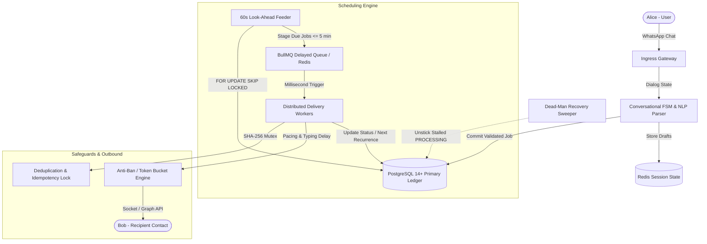
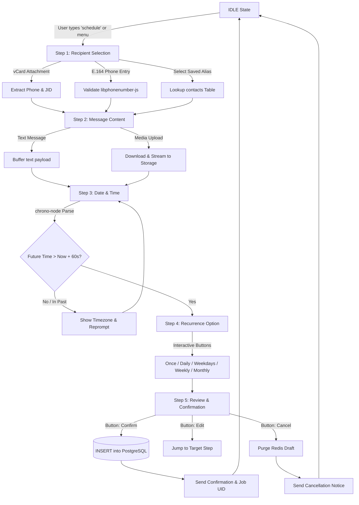

# WhatsApp In-App Message Scheduler Chatbot
## Master Architectural Specification & Implementation Blueprint

---

## 1. Executive Summary

This document specifies the complete, production-ready engineering architecture and implementation roadmap for an **In-WhatsApp Message Scheduler Chatbot**. The system allows any WhatsApp user (**Alice**) to interact conversationally with a bot inside WhatsApp to schedule arbitrary messages for future delivery to her personal contacts or group chats (**Bob**).

### The Five Core Architectural Challenges

1. **The Sender Identity Paradox**: 
   - *User Expectation (P2P)*: Alice expects the message to arrive on Bob's phone from her personal phone number, inside their existing chat thread.
   - *Official Meta Platform (B2C)*: Meta’s official WhatsApp Business Platform (Cloud API) delivers messages from the bot's registered Business Phone Number (WABA), not Alice's number. Bob receives an unsolicited message from an unfamiliar corporate entity.
2. **The 24-Hour Customer Service Window**:
   - Meta strictly prohibits sending free-form outbound messages to recipients who have not messaged the business within the preceding 24 hours (`Error 131047: Re-engagement message required`). Proactive messages require pre-approved paid template messages and documented opt-in consent. Unsolicited messages result in spam reports, downgrading the business number's Quality Rating to **RED** and risking permanent account suspension.
3. **Personal Account Automation & Anti-Ban Risks**:
   - Reverse-engineered multi-device WebSocket clients (such as **Baileys**) enable authentic P2P delivery from Alice’s personal phone number via a companion device session. However, Meta employs heuristic behavioral analysis (connection patterns, typing cadence, message velocity) that can trigger automated account bans (SIM bans) if human-like pacing is not strictly maintained.
4. **Persistent Scheduling at Scale**:
   - Scheduling messages from 1 minute to 12 months in advance requires balancing durable storage (zero data loss across service crashes) with sub-second execution accuracy without consuming massive Redis RAM or swamping PostgreSQL connection pools with polling queries.
5. **Daylight Saving Time (DST) Recurrence Drift**:
   - Standard UTC addition causes recurring reminders to drift by $\pm 1$ hour during seasonal clock changes.

---

## 2. Platform Feasibility & Trade-Off Matrix

We evaluated four primary technical approaches for WhatsApp connectivity:

```
+──────────────────────────┬───────────────────────┬───────────────────────┬──────────────────────────┬───────────────────────+
| Evaluation Criteria      | WhatsApp Cloud API    | Baileys               | whatsapp-web.js          | WPPConnect / Open-WA  |
+──────────────────────────┼───────────────────────┼───────────────────────┼──────────────────────────┼───────────────────────+
| Architecture             | Official REST Webhook | Pure WebSocket Engine | Puppeteer Browser Inject | Puppeteer + REST/CDP  |
| Underlying Runtime       | Meta Global Servers   | Node.js / TypeScript  | Chromium + Node.js       | Chromium + Node.js    |
| Protocol / Transport     | HTTPS / JSON (Graph)  | Noise_XX + Protobufs  | CDP / Webpack Store Hooks| CDP / WA-JS Wrapper   |
| Browser Dependency       | None                  | None (Pure Socket)    | Full Headless Chrome     | Full Headless Chrome  |
| Idle RAM per Session     | 0 MB (Serverless)     | 30 MB – 60 MB         | 150 MB – 350 MB          | 250 MB – 500 MB       |
| Startup / Handshake Time | < 50 ms (Stateless)   | 300 ms – 800 ms       | 5 s – 15 s               | 8 s – 20 s            |
| Concurrency on 4GB VPS   | 10,000+ Req/sec       | 60 – 100 Sessions     | 10 – 14 Sessions         | 6 – 8 Sessions        |
| Docker Image Size        | < 50 MB (App only)    | ~80 MB – 120 MB       | ~800 MB – 1.2 GB         | ~1.2 GB – 1.5 GB      |
| Outbound Sender ID       | Bot's Business WABA   | User's Personal Phone | User's Personal Phone    | User's Personal Phone |
| Autonomous Background Send| YES (Direct Relay)   | YES (Companion Node)  | YES (Browser Node)       | YES (Browser Node)    |
| 24-Hour Window Enforced  | YES (Error 131047)    | NO                    | NO                       | NO                    |
| Recipient Opt-In Mandate | YES (Explicit Consent)| NO (Unenforced)       | NO (Unenforced)          | NO (Unenforced)       |
| Account Ban Risk         | Zero (Official Meta)  | High (Pacing needed)  | High (Fingerprinted)     | High (Fingerprinted)   |
| Per-Message Meta Fees    | $0.0042 – $0.0380/msg  | $0.00 Meta Fees       | $0.00 Meta Fees          | $0.00 Meta Fees       |
| Official SLA & Support   | 99.99% Enterprise SLA | None (Community OSS)  | None (Community OSS)     | None (Community OSS)   |
+──────────────────────────┴───────────────────────┴───────────────────────┴──────────────────────────┴───────────────────────+
```

---

## 3. Two Supported Operational Delivery Models

To address the trade-off between policy compliance and user experience, the system supports two operational architectures:

```
                            OPERATIONAL DELIVERY COMPARISON

  [ MODEL A: Cloud API Assistive CTA ]             [ MODEL B: Baileys Companion Node ]
  
  Alice (User)                                     Alice (User)
       │                                                │
       │ 1. Schedule message                            │ 1. Scan QR (Multi-Device Link)
       ▼                                                │ 2. Schedule message
  [ Cloud API Bot ]                                     ▼
       │                                           [ Baileys Companion Node ]
       │ 2. At scheduled time:                          │
       │    Send interactive reminder to ALICE          │ 3. At scheduled time:
       ▼    with [ Send to Bob ] button                 │    Direct background socket send
  Alice's Phone                                         ▼
       │                                           Bob (Recipient)
       │ 3. Tap button -> Opens native chat to Bob      • Message comes from Alice's number
       ▼    with pre-filled text                        • 100% autonomous
  Bob (Recipient)                                       • Requires anti-ban pacing
  • 100% Meta compliant / Zero ban risk
  • Requires one tap from Alice
```

### Model A: Official Cloud API — Assistive Reminder Model (`wa.me` CTA Redirect)
- **Concept**: Alice communicates with the official WhatsApp Business Bot. Because Alice initiated contact, messaging her is 100% policy-compliant.
- **Workflow**: At the scheduled time, the bot does not attempt to send to Bob directly. Instead, it sends an urgent reminder to **Alice** containing an interactive Call-to-Action (CTA) URL button.
- **Redirect Mechanism**:
  1. Button links to `https://scheduler.app/r/{job_id}`.
  2. The endpoint looks up the job and returns an `HTTP 302 Redirect` to `whatsapp://send?phone={bob_phone}&text={url_encoded_msg}`.
  3. Alice's WhatsApp app opens directly into her existing chat thread with Bob, with the text pre-filled. Alice taps send.
- **Verdict**: 100% policy-compliant, zero ban risk, zero outbound fees, but requires a single tap from Alice.

### Model B: Personal Web Automation via Baileys Companion Node
- **Concept**: Alice links her personal WhatsApp account to the scheduler by scanning a multi-device QR code (or entering an 8-character pairing code). The bot runs as an official multi-device companion node using `@whiskeysockets/baileys`.
- **Workflow**: The scheduler maintains an encrypted WebSocket connection over the Noise_XX protocol. At the scheduled time, the worker dispatches the message directly from Alice's account to Bob.
- **Verdict**: 100% autonomous background delivery (Alice can be offline or asleep). Messages originate from Alice’s personal phone number. Requires anti-ban heuristics (typing simulation, jittered rate limiting) to protect Alice's account.

---

## 4. End-to-End System Topology



---

## 5. Conversational User Experience & State Machine

The bot provides two complementary interaction modes:
1. **Interactive 5-Step Guided Wizard** (optimized for mobile touchscreen interaction).
2. **Fast-Path Command-Line Grammar** (for power users).

### 5.1 The 5-Step Wizard State Machine



### 5.2 Fast-Path Direct Commands

For power users who prefer single-line execution:

| Command | Format | Example |
| :--- | :--- | :--- |
| **Schedule (One-Off)** | `/schedule <target> <time> \| <message>` | `/schedule +14155550199 tomorrow at 9am \| Don't forget our sync` |
| **Schedule (Recurring)**| `/schedule --repeat <rule> <target> <time> \| <message>` | `/schedule --repeat weekdays mom 8:30am \| Good morning!` |
| **List Jobs** | `/list [pending\|sent\|all] [page]` | `/list pending` |
| **Cancel Job** | `/cancel <job_uid>` | `/cancel job_9a2f1b` |
| **Edit Job** | `/edit <job_uid> <time\|message> <new_val>` | `/edit job_9a2f1b time tomorrow at 11am` |
| **Set Timezone** | `/timezone <IANA_zone>` | `/timezone America/New_York` |

---

## 6. Relational Data Architecture (PostgreSQL 14+)

### 6.1 Production DDL Schema

```sql
CREATE EXTENSION IF NOT EXISTS "uuid-ossp";

-- Enumerated Types
CREATE TYPE user_status_enum AS ENUM ('ACTIVE', 'SUSPENDED', 'BLOCKED');
CREATE TYPE recipient_type_enum AS ENUM ('INDIVIDUAL', 'GROUP');
CREATE TYPE message_type_enum AS ENUM ('TEXT', 'IMAGE', 'DOCUMENT', 'AUDIO', 'VIDEO', 'TEMPLATE');
CREATE TYPE recurrence_type_enum AS ENUM ('ONCE', 'DAILY', 'WEEKDAYS', 'WEEKLY', 'MONTHLY', 'CRON');
CREATE TYPE job_status_enum AS ENUM ('PENDING', 'QUEUED', 'PROCESSING', 'SENT', 'FAILED', 'CANCELLED', 'PAUSED');
CREATE TYPE misfire_policy_enum AS ENUM ('FIRE_IMMEDIATELY', 'SKIP', 'NOTIFY_USER');
CREATE TYPE execution_status_enum AS ENUM ('SUCCESS', 'FAILURE', 'RETRYING', 'MISFIRED');

-- Users & Timezone Configuration
CREATE TABLE users (
    id UUID PRIMARY KEY DEFAULT uuid_generate_v4(),
    phone_jid VARCHAR(64) NOT NULL UNIQUE,
    display_name VARCHAR(128),
    timezone VARCHAR(64) NOT NULL DEFAULT 'UTC',
    locale VARCHAR(16) NOT NULL DEFAULT 'en-US',
    status user_status_enum NOT NULL DEFAULT 'ACTIVE',
    created_at TIMESTAMPTZ NOT NULL DEFAULT NOW(),
    updated_at TIMESTAMPTZ NOT NULL DEFAULT NOW()
);

-- Contact Aliases & Address Book
CREATE TABLE contacts (
    id UUID PRIMARY KEY DEFAULT uuid_generate_v4(),
    user_id UUID NOT NULL REFERENCES users(id) ON DELETE CASCADE,
    contact_jid VARCHAR(64) NOT NULL,
    alias VARCHAR(64) NOT NULL,
    display_name VARCHAR(128),
    recipient_type recipient_type_enum NOT NULL DEFAULT 'INDIVIDUAL',
    created_at TIMESTAMPTZ NOT NULL DEFAULT NOW(),
    updated_at TIMESTAMPTZ NOT NULL DEFAULT NOW(),
    CONSTRAINT uq_user_alias UNIQUE (user_id, alias)
);

-- Scheduled Jobs (Master Persistent Queue)
CREATE TABLE scheduled_jobs (
    id BIGINT GENERATED ALWAYS AS IDENTITY PRIMARY KEY,
    job_uid VARCHAR(32) NOT NULL UNIQUE,
    user_id UUID NOT NULL REFERENCES users(id) ON DELETE CASCADE,
    recipient_jid VARCHAR(64) NOT NULL,
    recipient_type recipient_type_enum NOT NULL DEFAULT 'INDIVIDUAL',
    message_type message_type_enum NOT NULL DEFAULT 'TEXT',
    payload JSONB NOT NULL,
    user_timezone VARCHAR(64) NOT NULL,
    recurrence_type recurrence_type_enum NOT NULL DEFAULT 'ONCE',
    recurrence_rule VARCHAR(256),
    anchor_day_of_month INT,
    scheduled_at_utc TIMESTAMPTZ NOT NULL,
    next_run_at_utc TIMESTAMPTZ,
    misfire_policy misfire_policy_enum NOT NULL DEFAULT 'FIRE_IMMEDIATELY',
    misfire_grace_period_sec INT NOT NULL DEFAULT 3600,
    status job_status_enum NOT NULL DEFAULT 'PENDING',
    retry_count INT NOT NULL DEFAULT 0,
    max_retries INT NOT NULL DEFAULT 3,
    last_error TEXT,
    idempotency_key VARCHAR(128) NOT NULL UNIQUE,
    locked_at TIMESTAMPTZ,
    locked_by VARCHAR(64),
    created_at TIMESTAMPTZ NOT NULL DEFAULT NOW(),
    updated_at TIMESTAMPTZ NOT NULL DEFAULT NOW()
);

-- Partial B-Tree Index: Poller scans ONLY active pending jobs!
CREATE INDEX idx_scheduled_jobs_polling 
ON scheduled_jobs (next_run_at_utc ASC) 
WHERE status = 'PENDING';

CREATE INDEX idx_scheduled_jobs_user_list 
ON scheduled_jobs (user_id, status, created_at DESC);

-- Execution Audit Logs (Append-Only)
CREATE TABLE job_execution_logs (
    id BIGINT GENERATED ALWAYS AS IDENTITY PRIMARY KEY,
    job_id BIGINT NOT NULL REFERENCES scheduled_jobs(id) ON DELETE CASCADE,
    executed_at_utc TIMESTAMPTZ NOT NULL DEFAULT NOW(),
    status execution_status_enum NOT NULL,
    whatsapp_message_id VARCHAR(128),
    error_details TEXT,
    duration_ms INT,
    delivery_receipt JSONB
);

-- Baileys Multi-Device Companion Auth State
CREATE TABLE whatsapp_sessions (
    id UUID PRIMARY KEY DEFAULT uuid_generate_v4(),
    user_id UUID NOT NULL UNIQUE REFERENCES users(id) ON DELETE CASCADE,
    phone_number VARCHAR(32) NOT NULL,
    creds JSONB NOT NULL,
    is_active BOOLEAN NOT NULL DEFAULT FALSE,
    connected_at TIMESTAMPTZ,
    disconnected_at TIMESTAMPTZ,
    updated_at TIMESTAMPTZ NOT NULL DEFAULT NOW()
);

-- Baileys Signal Cryptographic Pre-Keys & E2EE State
CREATE TABLE whatsapp_signal_keys (
    id UUID PRIMARY KEY DEFAULT uuid_generate_v4(),
    session_id UUID NOT NULL REFERENCES whatsapp_sessions(id) ON DELETE CASCADE,
    key_type VARCHAR(32) NOT NULL,
    key_id VARCHAR(128) NOT NULL,
    key_data BYTEA NOT NULL,
    updated_at TIMESTAMPTZ NOT NULL DEFAULT NOW(),
    CONSTRAINT uq_session_key UNIQUE (session_id, key_type, key_id)
);
```

---

## 7. Two-Tier Hybrid Scheduling Engine

### 7.1 Architecture Rationale
- **Pure Redis Delay Queue**: Storing 100,000+ jobs scheduled months in advance consumes continuous, unpageable RAM.
- **Pure Database Polling**: 50 workers executing `SELECT ... FOR UPDATE SKIP LOCKED` every second causes database connection starvation and CPU spikes.
- **Two-Tier Hybrid Design**:
  1. **Tier 1 (PostgreSQL Master)**: Holds all future jobs durably with zero memory footprint.
  2. **Tier 2 (Look-Ahead Feeder Daemon)**: Every 60 seconds, a feeder queries PostgreSQL for jobs maturing within the next 5 minutes:
     ```sql
     SELECT id, job_uid, next_run_at_utc FROM scheduled_jobs
     WHERE status = 'PENDING' AND next_run_at_utc <= NOW() + INTERVAL '5 minutes'
     ORDER BY next_run_at_utc ASC
     LIMIT 500
     FOR UPDATE SKIP LOCKED;
     ```
  3. **Stage to BullMQ**: Jobs are pushed to BullMQ with millisecond precision (`delay = target_time - now`). BullMQ handles concurrent Redis execution with minimal memory usage ($< 250\text{ KB}$).

---

## 8. Recurrence Math & Wall-Clock DST Invariance

### 8.1 Wall-Clock Invariant Recurrence Formula

To guarantee that a 9:00 AM daily reminder never arrives at 8:00 AM or 10:00 AM when clocks change for Daylight Saving Time:

$$\text{Step 1: Convert UTC to User Local Time: } t_{\text{local}} = \mathcal{Z}_{\text{user\_tz}}(t_{\text{last\_utc}})$$
$$\text{Step 2: Add Interval in Calendar Dimension: } t_{\text{next\_local}} = t_{\text{local}} \oplus \Delta_{\text{days/months}}$$
$$\text{Step 3: Convert Local Time Back to UTC: } t_{\text{next\_utc}} = \mathcal{Z}_{\text{UTC}}(t_{\text{next\_local}})$$

### 8.2 Month-End Anchor Day Preservation

For monthly schedules created on the 31st:
- Jan 31 $\rightarrow$ Feb 28 (or 29 on leap year) $\rightarrow$ Mar 31 $\rightarrow$ Apr 30.
- Without an `anchor_day_of_month = 31`, standard date addition snaps Jan 31 to Feb 28, and subsequent months stay permanently stuck on the 28th. The recurrence engine preserves `anchor_day_of_month` across all future calculations.

---

## 9. Zero-Double-Send Guarantee & Reliability

1. **Deterministic Idempotency Key**:
   $$\text{idempotency\_key} = \text{SHA-256}(\text{job\_uid} + \text{"\_"} + \text{scheduled\_at\_utc\_iso})$$
   Enforced via a PostgreSQL unique constraint.
2. **Distributed Redis Mutex**:
   Before dispatch, the worker acquires a Redis mutex `lock:job:{id}:{idempotency_key}` with a 30-second TTL.
3. **Socket-Level Message Deduplication**:
   When using Baileys, the worker injects a deterministic `msgId` directly into the socket call. If a worker process is terminated (e.g. `SIGKILL`) immediately after socket transmission but before the DB transaction commits, the WhatsApp server recognizes the message ID and drops the duplicate.
4. **Dead-Man's-Switch Sweeper**:
   A background process runs every 60 seconds to detect orphaned records in `QUEUED` or `PROCESSING` state where `locked_at < NOW() - INTERVAL '5 minutes'`. It automatically resets them to `PENDING` for redelivery.
5. **Misfire Grace Period**:
   If the server suffers a 3-hour outage:
   - One-off jobs within the 1-hour grace period fire immediately (`FIRE_IMMEDIATELY`).
   - Recurring jobs are evaluated with `SKIP`, marking the overdue execution as `MISFIRED` in logs and fast-forwarding directly to the next future scheduled occurrence—preventing rapid-fire message spam upon system boot.

---

## 10. Anti-Ban Safeguards for Personal Accounts

When using personal Baileys sessions, the system applies humanized behavioral pacing:

1. **Multi-Modal Human Typing Delay**:
   Before dispatching a message, the bot sets the presence state to `composing` and waits:
   $$T_{\text{type}} = \min(5.0, \text{char\_count} \times 0.05 + \mathcal{N}(1.5, 0.4))\text{ seconds}$$
2. **Presence Transitions**:
   Transitions through `available` $\rightarrow$ `composing` $\rightarrow$ `paused` $\rightarrow$ `send`, mimicking real mobile client telemetry.
3. **Queue Pacing & Jitter**:
   Outbound messages from the same personal session are spaced by 3–6 seconds for existing contacts, and 8–15 seconds for new numbers.
4. **Session Error Handling**:
   - `401 Unauthorized`: Companion session unlinked by user. Immediately freeze scheduled jobs and notify user out-of-band.
   - `403 Forbidden`: Account ban. Immediately trigger circuit breaker to stop all outgoing socket calls.
   - `515 Restart Required`: WhatsApp server maintenance. Wait 5s and cleanly re-perform the handshake.

---

## 11. Phased Implementation Roadmap

```
+───────────────────────────────────────────────────────────────────────────────────────────────────+
|                                  PHASED IMPLEMENTATION ROADMAP                                    |
+──────────────────────────┬─────────────────────────────────────────────────┬──────────────────────+
| Phase & Milestone        | Core Technical Deliverables                     | Exit Criteria        |
+──────────────────────────┼─────────────────────────────────────────────────┼──────────────────────+
| Phase 1: Core Infra &    | • PostgreSQL schema migration & DDL scripts     | Clean socket sync;   |
| WhatsApp Socket Engine   | • Baileys Multi-Device auth state & Noise sync  | DB passes migration; |
| (Weeks 1–2)              | • WhatsApp Cloud API webhook receiver           | E2E ping-pong msg.   |
+──────────────────────────┼─────────────────────────────────────────────────┼──────────────────────+
| Phase 2: Conversational  | • Redis-backed 5-Step Wizard FSM                | Wizard schedules     |
| State Machine & UX       | • chrono-node temporal parser & libphonenumber  | valid job; /list and |
| (Weeks 3–4)              | • Fast-path direct command grammar (/schedule)  | /cancel operate cleanly|
+──────────────────────────┼─────────────────────────────────────────────────┼──────────────────────+
| Phase 3: PostgreSQL &    | • 60-second Look-Ahead Feeder daemon            | Jobs scheduled 30m   |
| Hybrid Scheduling Engine | • BullMQ delayed queue integration & worker pool| ahead fire with      |
| (Weeks 5–6)              | • Single Active Row recurrence engine (luxon)   | sub-second precision.|
+──────────────────────────┼─────────────────────────────────────────────────┼──────────────────────+
| Phase 4: Anti-Ban &      | • Stale lock recovery sweeper (dead-man's-switch)| Zero double sends    |
| Failure Recovery         | • Deterministic SHA-256 idempotency locks       | under chaos testing; |
| (Weeks 7–8)              | • Multi-modal typing simulation & rate limiters | 401/515 auto-handled.|
+──────────────────────────┼─────────────────────────────────────────────────┼──────────────────────+
| Phase 5: E2E Verification| • End-to-end integration & load testing         | 10k messages/hr peak;|
| & Production Deployment  | • Docker compose & Kubernetes Helm manifests    | 99.95% delivery SLA; |
| (Weeks 9–10)             | • Prometheus / Grafana observability dashboards | production sign-off. |
+──────────────────────────┴─────────────────────────────────────────────────┴──────────────────────+
```

---

## 12. Workspace Documentation Links

The deep-dive technical specifications, test harnesses, and benchmark data generated for this project are available in your local repository:
- 📘 **Master Implementation Plan**: [WHATSAPP_SCHEDULER_TECHNICAL_PLAN.md](file:///C:/Users/Lenovo/teamwork_projects/whatsapp_scheduler_bot/WHATSAPP_SCHEDULER_TECHNICAL_PLAN.md)
- 📊 **Feasibility & Platform Architecture**: [FEASIBILITY_AND_PLATFORM_ARCHITECTURE.md](file:///C:/Users/Lenovo/teamwork_projects/whatsapp_scheduler_bot/docs/FEASIBILITY_AND_PLATFORM_ARCHITECTURE.md)
- ⚙️ **System Design & Scheduling Spec**: [SYSTEM_DESIGN_AND_SCHEDULING_SPECIFICATION.md](file:///C:/Users/Lenovo/teamwork_projects/whatsapp_scheduler_bot/docs/SYSTEM_DESIGN_AND_SCHEDULING_SPECIFICATION.md)
- 🗂️ **Project Architecture**: [PROJECT.md](file:///C:/Users/Lenovo/teamwork_projects/whatsapp_scheduler_bot/PROJECT.md)
