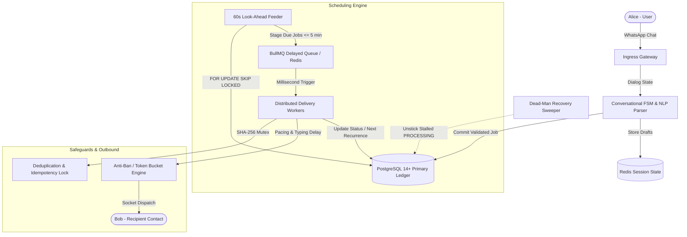

# In-WhatsApp Message Scheduler Chatbot: Architectural Blueprint & Master Plan

## 1. Executive Summary

This plan provides the complete technical architecture and implementation roadmap for an **In-WhatsApp Message Scheduler Chatbot**. The bot operates directly inside WhatsApp, allowing users (**Alice**) to schedule messages for future delivery to their personal contacts or group chats (**Bob**).

### The Core Architectural Dilemmas

1. **The Sender Identity Paradox**: 
   - **User Expectation (Peer-to-Peer)**: Alice expects messages to be delivered from her own personal phone number inside her existing 1-on-1 chat with Bob.
   - **Official WhatsApp Business Platform (Cloud API)**: The Cloud API dispatches messages strictly from the registered Business Phone Number (WABA). Bob receives an unexpected message from a corporate business number rather than Alice.
2. **The 24-Hour Customer Service Window**:
   - Meta prohibits free-form messages to recipients who have not messaged the business number within the prior 24 hours (`Error 131047: Re-engagement message required`). Proactive outreach requires pre-approved paid template messages and documented opt-in consent. Relaying unconsented messages causes spam flags and business account bans.
3. **Personal Account Automation & Anti-Ban Risks**:
   - Using personal WhatsApp multi-device client engines (e.g. **Baileys** over the Noise_XX protocol) allows authentic P2P delivery from Alice’s number, but requires behavioral pacing (burst typing, inter-word pauses, message staggering) to prevent Meta automated SIM bans.
4. **Persistent Scheduling at Scale**:
   - Storing jobs scheduled months ahead directly in Redis memory leads to high RAM costs. Pure PostgreSQL polling causes high database CPU utilization. A **Two-Tier Hybrid Scheduler** (PostgreSQL persistence + BullMQ 5-minute look-ahead buffer) solves both issues.
5. **Daylight Saving Time (DST) Recurrence Drift**:
   - Naive UTC addition causes recurring reminders to drift by $\pm 1$ hour across seasonal clock changes.

---

## 2. Approach Comparison & Trade-Off Matrix

```
+──────────────────────────┬────────────────────────────┬─────────────────────────────+
| Feature / Metric         | Official Cloud API (B2C)   | Baileys Multi-Device (P2P)  |
+──────────────────────────┼────────────────────────────┼─────────────────────────────+
| Outbound Sender ID       | Bot's Business WABA Number | User's Personal Number      |
| Background Delivery      | Fully Autonomous           | Autonomous (Companion node) |
| Recipient Eligibility    | Must opt in / 24h window   | Any valid WhatsApp user     |
| 24h Service Window Block | Enforced (Requires template| Not enforced                |
| Ban / Policy Risk        | Zero (Official Meta API)   | High without human pacing   |
| Meta Messaging Fees      | $0.0042 – $0.0380 / msg    | $0.00 (Self-hosted)         |
| Primary Recommended Mode | **Assistive CTA Redirect** | **Companion Node Auto-Send**|
+──────────────────────────┴────────────────────────────┴─────────────────────────────+
```

### The Two Viable Deployment Models

1. **Option A: Official Cloud API — Assistive Reminder Model (`wa.me` CTA Redirect)**
   - Alice converses with the official business bot to set a schedule.
   - At the scheduled time, the bot sends an alert to **Alice** with an interactive button (`[ Send to Bob ]`).
   - Tapping the button triggers a deep-link (`whatsapp://send?phone=...&text=...`), launching Alice's native WhatsApp chat with Bob with the text pre-filled. Alice simply taps send.
   - **Pros**: 100% policy-compliant, zero ban risk, zero outbound recipient fees.
   - **Cons**: Requires Alice to tap the notification.
2. **Option B: Personal Account Automation — Baileys Companion Node**
   - Alice pairs her personal account with the scheduler via a multi-device QR code.
   - The scheduler acts as a headless companion device (like WhatsApp Web).
   - At the scheduled time, the bot transmits the message directly from Alice's account to Bob.
   - **Pros**: 100% autonomous background delivery even if Alice is offline or asleep; arrives from Alice's number.
   - **Cons**: Requires active anti-ban safeguards (typing simulation, jittered rate limiting, session monitoring).

---

## 3. High-Level System Architecture



---

## 4. Key Subsystems & Design Specifications

### 4.1 Dual-Mode Conversational UX
- **Interactive 5-Step Wizard**:
  1. *Recipient*: Interactive selection via vCard contact attachment, saved alias, or E.164 phone number.
  2. *Message Payload*: Text, image, document, audio, or video.
  3. *Timing*: Natural language temporal parsing via `chrono-node` (e.g., *"tomorrow at 9:30 AM"*, *"in 2 hours"*).
  4. *Recurrence*: Once, Daily, Weekdays, Weekly, Monthly.
  5. *Review & Confirm*: Interactive summary with `[ Confirm ]`, `[ Edit ]`, and `[ Cancel ]` buttons.
- **Fast-Path Command Line**:
  - `/schedule <contact> <time> | <message>`
  - `/list [status]`
  - `/cancel <job_id>`
  - `/edit <job_id> <field> <value>`
  - `/timezone <IANA_zone>`

### 4.2 Durable Data Architecture (PostgreSQL 14+)
- **Core Entities**: `users`, `contacts`, `scheduled_jobs`, `job_execution_logs`, `whatsapp_sessions`, `whatsapp_signal_keys`.
- **Performance Indexing**: Partial B-Tree index on `(next_run_at_utc ASC) WHERE status = 'PENDING'` ensures polling queries scan only active pending records in $< 1.0\text{ ms}$.
- **Zero Double-Send Guarantee**:
  - Deterministic idempotency key: $\text{SHA-256}(\text{job\_uid} + \text{"\_"} + \text{scheduled\_at\_utc\_iso})$.
  - Distributed Redis mutex before socket transmission.
  - WhatsApp client message ID passed into the socket to ensure deduplication even during post-transmission crashes.

### 4.3 Recurrence & Wall-Clock DST Invariance
- **Single Active Row Model**: Only the next upcoming execution exists in `scheduled_jobs`. Once executed, the worker advances `next_run_at_utc` in place.
- **Wall-Clock Math**: Converts UTC to the user's local timezone (via `luxon`), increments by calendar days/months with an `anchor_day_of_month` (ensuring 31st dates handle February correctly), and converts back to UTC.

### 4.4 Failure Resilience & Recovery
- **Dead-Man's-Switch Sweeper**: Scans every 60s for jobs stuck in `PROCESSING` longer than 5 minutes and returns them to `PENDING`.
- **Misfire Policies**: `FIRE_IMMEDIATELY` (within 1-hour grace window), `SKIP` (advances recurring jobs without spamming outdated text), or `NOTIFY_USER` (interactive confirmation for critical tasks).
- **Socket Session Recovery**: Auto-reconnect with exponential backoff on network blips and error 515 (`restartRequired`); circuit breakers on error 403 (SIM ban protection).

---

## 5. Phased Implementation Roadmap

```
+──────────+──────────────────────────────+──────────────────────────────────────────────+
| Phase    | Timeline                     | Key Focus                                    |
+──────────+──────────────────────────────+──────────────────────────────────────────────+
| Phase 1  | Weeks 1–2                    | Core Database DDL, WhatsApp Socket Handshake |
| Phase 2  | Weeks 3–4                    | Conversational State Machine & NLP Parsing   |
| Phase 3  | Weeks 5–6                    | Hybrid Look-Ahead Feeder & BullMQ Queue      |
| Phase 4  | Weeks 7–8                    | Anti-Ban Heuristics, Idempotency & Sweepers  |
| Phase 5  | Weeks 9–10                   | End-to-End Stress Testing & Production Deploy|
+──────────+──────────────────────────────+──────────────────────────────────────────────+
```

---

## 6. Complete Documentation Repository

Detailed engineering artifacts, DDL scripts, mathematical proofs, and code implementations generated in the workspace:
- **Master Plan**: [WHATSAPP_SCHEDULER_TECHNICAL_PLAN.md](file:///C:/Users/Lenovo/teamwork_projects/whatsapp_scheduler_bot/WHATSAPP_SCHEDULER_TECHNICAL_PLAN.md)
- **Feasibility & Platform Architecture**: [FEASIBILITY_AND_PLATFORM_ARCHITECTURE.md](file:///C:/Users/Lenovo/teamwork_projects/whatsapp_scheduler_bot/docs/FEASIBILITY_AND_PLATFORM_ARCHITECTURE.md)
- **System Design & Scheduling Spec**: [SYSTEM_DESIGN_AND_SCHEDULING_SPECIFICATION.md](file:///C:/Users/Lenovo/teamwork_projects/whatsapp_scheduler_bot/docs/SYSTEM_DESIGN_AND_SCHEDULING_SPECIFICATION.md)
- **Project Structure**: [PROJECT.md](file:///C:/Users/Lenovo/teamwork_projects/whatsapp_scheduler_bot/PROJECT.md)
