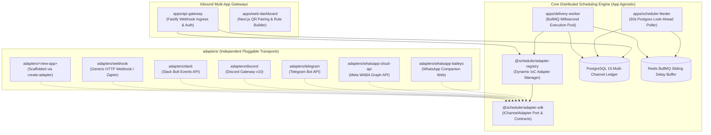

# Implementation Plan: Omnichannel & Multi-App Extensible Monorepo Boilerplate

## Goal Description
Spin up an enterprise-grade, modular, and adaptable **TypeScript Monorepo** for the **Omnichannel Message Scheduler Platform**.

The repository is explicitly architected with a **Pluggable Integration Architecture** to support any third-party messaging platform or application integration (WhatsApp, Telegram, Discord, Slack, Signal, Viber, SMS/Twilio, Line, Email, and generic Webhooks) with **zero modifications to core scheduling, queuing, or database layers**.

Massive distributed developer squads can autonomously author, test, and release independent channel adapters via a standardized **Adapter Plugin SDK**, complete with automated contract tests (`@scheduler/adapter-test-kit`) and a built-in scaffolding CLI (`npm run create:adapter`).

---

## User Review Required

> [!IMPORTANT]
> **Extensible Channel Identification**: Rather than locking the database schema to a static Postgres Enum for channels, we propose using a **normalized string-based `channel_id` + channel metadata table** or an open discriminator (`ChannelType = string`). This allows new third-party integrations (e.g. Line, WeChat, Twilio SMS, PagerDuty, Discord) to be deployed and registered dynamically without requiring destructive database migrations.

> [!IMPORTANT]
> **Adapter Independence & Isolation**: Each adapter in `adapters/*` is an independent npm workspace package with its own `package.json` and external dependencies. A dependency change or security upgrade in `@whiskeysockets/baileys` will never touch or destabilize `discord.js`, `telegraf`, or `@slack/bolt`.

---

## Open Questions

> [!NOTE]
> 1. **Default Starter Adapters**: To demonstrate the multi-app architecture immediately in this boilerplate, we propose scaffolding:
>    - `adapters/whatsapp-baileys` (Socket Companion Device)
>    - `adapters/whatsapp-cloud-api` (Official Meta Graph REST)
>    - `adapters/telegram` (Telegram Bot API)
>    - `adapters/discord` (Discord Gateway Bot)
>    - `adapters/slack` (Slack Bolt API)
>    - `adapters/webhook` (Generic Outbound HTTP Webhook / Zapier / Make integration)
>    Would you like to include or prioritize any additional channels in the initial boilerplate (e.g. Twilio SMS, Signal)?
> 2. **Authentication & Session Storage**: Personal session-based adapters (like WhatsApp Baileys or Signal) require persisting pairing sessions, whereas bot-token adapters (Telegram, Discord, Slack) only require API tokens. We propose a unified `ChannelAccount` database entity with encrypted metadata envelopes. Does this align with your multi-tenant expectations?

---

## Omnichannel Architectural Topology



---

## The Pluggable Integration Contract (`@scheduler/adapter-sdk`)

Every messaging platform or app integration conforms to a strict, typed contract:

```typescript
// packages/adapter-sdk/src/channel-adapter.interface.ts

export interface ChannelCapabilities {
  supportsRichText: boolean;
  supportsMarkdown: boolean;
  supportsMedia: ('IMAGE' | 'VIDEO' | 'AUDIO' | 'DOCUMENT')[];
  supportsButtons: boolean;
  supportsReactions: boolean;
  supportsDeliveryReceipts: boolean;
  requiresPersistentSession: boolean; // e.g. Baileys socket vs Telegram stateless REST
  maxPayloadLength: number;
  rateLimit: {
    maxPerMinute: number;
    burst: number;
    recommendedJitterMs: number;
  };
}

export interface IChannelAdapter {
  readonly channelId: string;       // e.g. 'whatsapp-baileys', 'telegram', 'slack'
  readonly displayName: string;     // e.g. 'Telegram Messenger'
  readonly capabilities: ChannelCapabilities;

  /** Initialize adapter, connect sockets, or verify API keys */
  initialize(accountConfig: ChannelAccountConfig): Promise<void>;

  /** Gracefully terminate connections, flush state */
  shutdown(accountId: string): Promise<void>;

  /** Check connection health and authentication status */
  checkHealth(accountId: string): Promise<HealthStatus>;

  /** Validate recipient address (phone number, chat ID, username, channel ID) */
  validateRecipient(accountId: string, recipientId: string): Promise<RecipientValidationResult>;

  /** Execute delivery of scheduled message */
  sendMessage(job: ScheduledMessageJob): Promise<DeliveryReceipt>;

  /** Optional: Simulate human typing or status indicator */
  simulateActivity?(accountId: string, recipientId: string, durationMs: number): Promise<void>;

  /** Optional: Handle incoming webhook payload from this provider */
  handleWebhook?(payload: unknown, headers: Record<string, string>): Promise<WebhookProcessResult>;
}
```

---

## Monorepo Directory Layout (Omnichannel Scale)

```tree
scheduler/
├── package.json                         # Root workspaces definition (apps, packages, adapters, tools)
├── turbo.json                           # Turborepo task pipeline & caching
├── tsconfig.base.json                   # Root TypeScript compiler options
├── .gitignore
├── .editorconfig
├── .env.example
├── docker/
│   ├── docker-compose.yml               # Local Postgres 16, Redis 7
│   ├── Dockerfile.base                  # Base Docker image
│   ├── Dockerfile.gateway               # Gateway container
│   ├── Dockerfile.worker                # Delivery worker container
│   └── Dockerfile.feeder                # Feeder cron container
│
├── apps/                                # Deployable Services
│   ├── api-gateway/                     # Inbound webhook receiver & public REST APIs
│   │   ├── package.json
│   │   ├── tsconfig.json
│   │   └── src/
│   │       ├── server.ts
│   │       ├── routes/webhooks/         # /api/webhooks/:channelId dynamic routing
│   │       └── routes/schedules/        # CRUD for scheduling jobs
│   ├── scheduler-feeder/                # 60s look-ahead cron feeder (DB -> Redis)
│   │   ├── package.json
│   │   └── src/feeder.service.ts
│   ├── delivery-worker/                 # BullMQ execution worker pool
│   │   ├── package.json
│   │   └── src/worker.processor.ts      # Pulls job, resolves adapter, dispatches
│   └── web-dashboard/                   # Next.js admin & connection manager UI
│
├── adapters/                            # Pluggable App Integrations
│   ├── whatsapp-baileys/                # WhatsApp Companion Multi-Device Socket
│   ├── whatsapp-cloud-api/              # Meta Graph API (Official Business)
│   ├── telegram/                        # Telegram Bot API (Telegraf / Grammy)
│   ├── discord/                         # Discord Gateway Bot (Discord.js)
│   ├── slack/                           # Slack Bolt App
│   ├── webhook/                         # Generic Outbound HTTP Webhook
│   └── README.md                        # Guide on creating new adapters
│
├── packages/                            # Shared Internal Libraries
│   ├── adapter-sdk/                     # Core IChannelAdapter port & types
│   ├── adapter-registry/                # Dynamic IoC adapter registration & discovery
│   ├── adapter-test-kit/                # Standardized test suite for any new adapter
│   ├── types/                           # Universal DTOs, Enums, Job schemas
│   ├── database/                        # PostgreSQL layer with Prisma / Drizzle
│   │   └── prisma/schema.prisma         # Generic multi-channel schema
│   ├── queue/                           # BullMQ abstraction & Redis manager
│   ├── crypto/                          # AES-256-GCM zero-knowledge envelopes
│   ├── temporal/                        # Timezone & DST Recurrence Engine
│   ├── logger/                          # Pino structured logger & PII redactor
│   └── config/                          # Zod-validated environment config
│
└── tools/                               # Developer Velocity Tooling
    ├── create-adapter/                  # CLI generator: npm run create:adapter --name <channel>
    ├── eslint-config/                   # Shared linting
    └── typescript-config/               # Shared tsconfigs
```

---

## Developer Velocity: The `create-adapter` Tool

For massive developer teams, creating a new integration must take seconds. A custom tool will be placed in `tools/create-adapter`:

```powershell
# Usage:
npm run create:adapter -- --name viber --display "Viber Messenger"
# Automatically generates:
#   adapters/viber/package.json
#   adapters/viber/tsconfig.json
#   adapters/viber/src/viber.adapter.ts (implements IChannelAdapter)
#   adapters/viber/test/viber.spec.ts (using @scheduler/adapter-test-kit)
```

---

## Generic Multi-Channel Database Schema

The database is built from day one to handle any platform without schema changes:

```prisma
// packages/database/prisma/schema.prisma

enum JobStatus {
  SCHEDULED
  STAGED_IN_QUEUE
  PROCESSING
  DELIVERED
  FAILED
  CANCELLED
}

model ChannelAccount {
  id               String       @id @default(uuid()) @db.Uuid
  userId           String       @map("user_id") @db.VarChar(128)
  channelId        String       @map("channel_id") @db.VarChar(64) // 'whatsapp-baileys', 'telegram', 'slack', etc.
  accountIdentifier String      @map("account_identifier") @db.VarChar(128) // phone, bot user, email, webhook url
  
  // Encrypted auth state / tokens (session string, bot token, oauth credentials)
  encryptedAuthData Bytes       @map("encrypted_auth_data")
  authDataIv        Bytes       @map("auth_data_iv")
  authDataTag       Bytes       @map("auth_data_tag")
  
  isActive         Boolean      @default(true) @map("is_active")
  createdAt        DateTime     @default(now()) @map("created_at") @db.Timestamptz(6)
  updatedAt        DateTime     @updatedAt @map("updated_at") @db.Timestamptz(6)

  schedules        ScheduledMessage[]

  @@unique([userId, channelId, accountIdentifier])
  @@map("channel_accounts")
}

model ScheduledMessage {
  id               String          @id @default(uuid()) @db.Uuid
  userId           String          @map("user_id") @db.VarChar(128)
  channelAccountId String          @map("channel_account_id") @db.Uuid
  channelAccount   ChannelAccount  @relation(fields: [channelAccountId], references: [id])
  
  channelId        String          @map("channel_id") @db.VarChar(64)
  recipientId      String          @map("recipient_id") @db.VarChar(255) // phone, chat_id, slack channel, webhook endpoint
  
  // Zero-knowledge encrypted payload
  encryptedPayload Bytes           @map("encrypted_payload")
  payloadIv        Bytes           @map("payload_iv")
  payloadAuthTag   Bytes           @map("payload_auth_tag")
  keyFingerprint   String          @map("key_fingerprint") @db.VarChar(64)
  
  // Timing & Recurrence
  scheduledFor     DateTime        @map("scheduled_for") @db.Timestamptz(6)
  timezone         String          @default("UTC") @db.VarChar(64)
  cronExpression   String?         @map("cron_expression") @db.VarChar(128)
  recurrenceRule   String?         @map("recurrence_rule") @db.VarChar(255)
  parentScheduleId String?         @map("parent_schedule_id") @db.Uuid
  
  // Execution & Mutex
  status           JobStatus       @default(SCHEDULED)
  idempotencyKey   String          @unique @map("idempotency_key") @db.VarChar(64)
  executionWorker  String?         @map("execution_worker") @db.VarChar(128)
  stagedAt         DateTime?       @map("staged_at") @db.Timestamptz(6)
  deliveredAt      DateTime?       @map("delivered_at") @db.Timestamptz(6)
  retryCount       Int             @default(0) @map("retry_count")
  lastError        String?         @map("last_error") @db.Text
  
  createdAt        DateTime        @default(now()) @map("created_at") @db.Timestamptz(6)
  updatedAt        DateTime        @updatedAt @map("updated_at") @db.Timestamptz(6)

  @@index([status, scheduledFor], name: "idx_due_jobs")
  @@index([userId, channelId], name: "idx_user_channel")
  @@map("scheduled_messages")
}
```

---

## Verification Plan

### Automated Verification
```powershell
# 1. Initialize git repository if not initialized
git init

# 2. Install monorepo dependencies and Turborepo
npm install

# 3. Test Adapter SDK test-kit on all scaffolded adapters (WhatsApp, Telegram, Discord, Slack, Webhook)
npm run test

# 4. Verify TypeScript compilation across all apps, packages, and adapters
npm run typecheck

# 5. Verify Turborepo pipeline build execution
npm run build

# 6. Test the create-adapter scaffolding CLI
npm run create:adapter -- --name test-mock --display "Test Mock Adapter"
```

### Manual Verification
1. Verify that `apps/delivery-worker` loads and dispatches to multiple channels through the dynamic `AdapterRegistry`.
2. Verify that creating a new adapter in `adapters/` requires zero modifications to `apps/scheduler-feeder` or `packages/queue`.
3. Confirm all existing documentation in `docs/` is linked and preserved.
